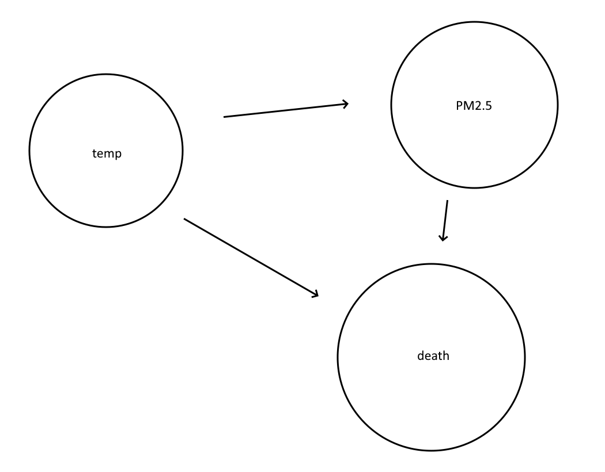

```{r}
library(tidyverse)
library(MatchIt)
df_read <- read_csv("pm25_data.csv")
```

1.  

{width="355"}

2.  

```{r}
df <- df_read %>% drop_na() %>% mutate(above = as.integer(above == "above"))

ps_model <- matchit(above ~ temp,
                    data = df,
                    method = "nearest",
                    distance = "glm",
                    replace = TRUE)

print(ps_model)
summary(ps_model)
```

3\.

```{r}
matched_data <- match.data(ps_model)

lin <- lm(death ~ above, data = matched_data, weights = weights)
summary(lin)

```

4\.

Decisions changed:

1- Match on days where PM2.5 levels are below 35 instead of days where PM2.5 levels were above 35.

2- Fit a regression model on the PM2.5 level rather than the indicator function of whether PM2.5 was above 35.

```{r}
df2 <- df_read %>% drop_na() %>% mutate(above = as.integer(above == "below"))

ps_model2 <- matchit(above ~ temp,
                    data = df2,
                    method = "nearest",
                    distance = "glm",
                    replace = TRUE)

print(ps_model2)
summary(ps_model2)
matched_data2 <- match.data(ps_model2)

lin2 <- lm(death ~ above, data = matched_data2, weights = weights)
summary(lin2)
############
lin3 <- lm(death ~ pm25, data = matched_data, weights = weights)
summary(lin3)


```

1\.

Controlling for temperature, the causal effect of having PM2.5 levels above the 35 𝜇g/m3 standard is about 0.5256 more deaths per day. The p value of 0.873 suggests that there is no significant difference in deaths for days with higher PM2.5 levels. There is no significant evidence that PM2.5 levels above the 35 𝜇g/m3 standard causes excess daily mortality in New York City.

2\.

The strength of evidence in this analysis is relatively weak. There were only 178 days where the PM2.5 levels were above the standard, compared to the original dataset spanning multiple years. Additionally, more confounders may exist which were not accounted for, such as year-by-year technological, environmental, and health-based developments.
